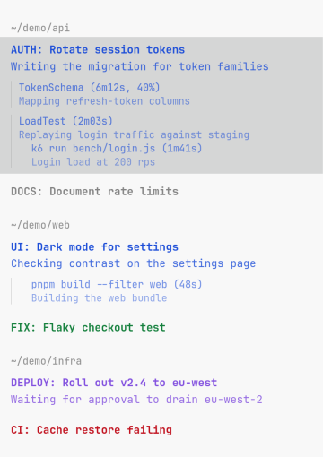
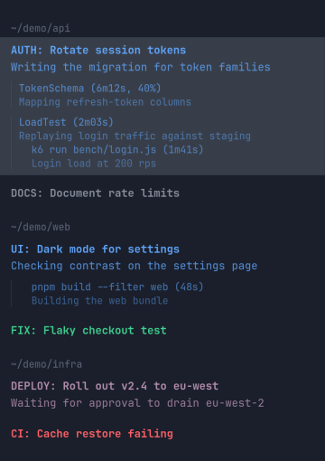

# Tern Simple Agent Sidebar

A plain agent sidebar for [Tern](https://stencil.so/tern): the agents of every Tern session in the window, grouped by working directory and hand-orderable. Each row shows the agent's title and what it is doing now, then its running subagents (elapsed, todo progress) and background jobs.

Started from [Arcadia822/tern-agent-nav](https://github.com/Arcadia822/tern-agent-nav) (MIT); this fork reworks it into per-tab rails with subagent and background-job tracking for omp.

| Light | Dark |
| --- | --- |
|  |  |

Screenshots use demo data.

## Usage

- **Ctrl+Alt+N** or command palette `Agent Nav: Toggle`: Open or close the navigator rail in every tab.
- Command palette `Agent Nav: Toggle left / right`: Move every rail to the other window edge.
- Command palette `Agent Nav: Reset Width`: Reset rail width to the default ratio (20% of the tab).
- Click any agent row: Immediately switches to that agent's Tern session and focuses its pane.
- **Shift-click a row, then click another row**: Moves the picked-up row directly above the clicked one and remembers the order. Shift-click the picked row again, or plain-click it, to cancel. The canvas delivers clicks only, so this is the closest equivalent of dragging.

## Behavior & Design

- **One rail per tab**: Every tab of every session in the window holds its own canvas rail, and all of them draw the same view, so switching tabs moves and resizes nothing. A single rail moved into the shown tab could only follow the `focus` event, which arrives after the switch has painted, so it always landed a few frames late. Rails are created for every tab up front, two per tick, so even a first visit to a tab shows the rail already in place. A tab that holds only its rail closes it; a rail whose tab closed goes with it.
- **Proportional fixed width, synced across tabs**: `agent_nav.share` is the rail's fraction of the whole tab width, measured as the product of the horizontal split ratios along the path from the tab root — so a rail beside the edge pane of a multi-pane tab is measured in tab width, not in its own split. Dragging a divider updates the share once it holds still, and every other tab is fitted to it through Tern's fractional-cell resize operations, three per pass and the rest on the next pass. A tab is fitted before it is drawn when it is switched to, so a switch never shows a stale width, and the shown tab is never pulled back while a divider is under the pointer. Moving a rail to the other edge sets `agent_nav.side`, and the other tabs follow.
- **Grouped by directory**: agents that share a working directory sit under one small directory label; rows show only their titles. A row's lines stack: title, what the agent is doing, then one block per subagent — its name and elapsed, its doing line, and its own jobs — each block separated by a small gap and a faint left rule. The first row of a group decides where the group sits, and rows inside a group keep their own order.
- **Order**: no session or tab headers. A row the user moved keeps the remembered position (`agent_nav.order`, a list of pane ids); rows it does not list follow in native order — Tern session order, then tab position, then pane order. Moving a row only reorders: it never changes which directory an agent belongs to. Closing a pane drops it from the remembered order.
- **Sandbox tags**: a root agent row (never a subagent) shows how the `sandbox` wrapper launched its harness, as small 2px-rounded pills on a line above the title: `kubernetes` for `sandbox -k`, `privileged` for `-p`, both for `-k -p`, `unsandboxed` when no `bwrap` process is in the pane's foreground chain, nothing for default strict. A cached async lookup reads `SANDBOX_K8S` / `SANDBOX_PERMISSIVE` from the `bwrap` process's `/proc/<pid>/environ` (only a real `bwrap` counts as sandboxed: the wrapper exports `_SANDBOX_INSIDE` even when `SANDBOX_DISABLED=1`), re-reading environ only when the foreground pid changes. Linux only.
- **Titles and harness**: each row shows the agent's pane title (omp, Codex and Copilot write their session title there). A row's harness comes from the command the block was opened with, then the pane's foreground program and command line, then its title. When those fields do not identify a harness, terminal and agent blocks also use a cached asynchronous foreground-process lookup; an agent started before installation can appear as soon as that lookup identifies it, without a new turn or focus change. Names match only as whole words (`claude-code`, `codex-acp` stay whole), so `components/` or `prompt` is never read as omp. Tern reports every command block as an agent block, so a launched command that names no harness and has not reported a turn (`working`, `waiting_input`) since the plugin loaded is not listed at all — a `pnpm run` block stays out of the rail; once a block does report a turn, it keeps its row with a first-character avatar instead of another harness's logo.
- **Subagents**: a row lists the subagents its agent has at work, with what each is doing. omp keeps an agent live from its spawn until it parks or is killed: parking (the `task.agentIdleTtlMs` idle timeout, 7 minutes by default) disposes the session and writes a `session_exit` record, and a kill also drops a `<transcript>.tombstone` beside it; a cancelled task ends on an assistant record with `stopReason:"aborted"`. A row shows the role omp spawned the agent as (`task`, `scout`, `tester`, ...), read from the agent's own `session_init` record. The list is a tree: omp nests an agent's own children under its artifacts dir, named after it — `<Name>.jsonl`, then `<Name>/<Name>.<Child>.jsonl`, then `<Name>/<Name>.<Child>/<Name>.<Child>.<Grandchild>.jsonl` — so the scan walks that shape level by level, descending only into an agent it lists, and each child's block nests one indent deeper inside its parent's block, after the parent's jobs. A child shows its own name with the parent prefix stripped (`OpenSignup.LandingSignup` reads `LandingSignup`). A live transcript mid-turn is a running agent (elapsed and todo percent shown). After a final assistant reply the agent is idle: omp keeps it messageable until its TTL, but the rail lists it only while it still has background jobs running (they will wake it), muted and labelled `(waiting on N jobs)` in place of the clock; an idle agent with nothing running is finished work and is hidden. omp writes one session file per agent and a parent's async subagents keep theirs beside it as `<Name>.jsonl`; the newest intent near the end of a live transcript is its current work. Those files are read off the UI path every four seconds (`tern inspect --json` for the session directories, then one shell pass per directory), so async spawns appear even when the parent never calls `wait`, and a subagent stays listed while its parent turn is over. A `__`-prefixed file is internal and skipped; a file untouched for 30 minutes is dropped.
- **Background jobs**: a row also lists its agent's running bash/eval jobs, as a short label with its elapsed time, and the intent omp recorded on the line below; a running subagent's own async jobs nest one indent deeper inside that subagent's block. A job label drops a leading `cd … &&`, environment assignments and `timeout N`, then clips to 32 characters, while the full command stays on the row's hover title. A subagent's jobs come from its own `<Name>.jsonl`, read only while that subagent is listed as running, and its cache is dropped as soon as it goes done or away. Task jobs are not listed here — they are the subagents above, read from their own session files. Every transcript (the parent's and each running subagent's) is read incrementally: the first pass takes the whole file and later passes only the bytes appended since the last one, so a 47 MB transcript costs one full read and then a few milliseconds per poll. `agent_nav.jobs` keeps the byte offset, the byte length of line 1 (omp rewrites the title record in place and keeps its length stable, so the length is the identity that survives retitles) and the job state, so a reload continues where it left off; a file that shrank, or whose line 1 changed length, restarts the pass. A spawn record opens a job, a settled status closes it, and the `wait` tool's `## Still Running` snapshot is authoritative for what is running at that point — so a job whose process died without a record (killed, or a session that resumed) drops out instead of haunting the rail. All of it runs in the same four-second shell pass as the subagent files — one process per directory, however many transcripts it reads — and only compact event lines leave the shell.
- **Row states**: running is blue, finished and unread is green, and error is semibold red. These semantic hues stay consistent across color themes, with separate light/dark values for readability. Waiting for input uses the theme's purple, and read rows use secondary text. Only the focused agent row carries a background: a 9% tint of the theme's strongest text color, so the selected agent reads the same in light and dark; status, hover, and press never add colored backgrounds.
- **State sources and precedence**: native `agent_state` events repaint rows immediately, including the selected row, without waiting for a focus or title change. Polling remains the fallback for terminal screen hints. Authoritative agent-block state (omp and wrapped chat agents) is trusted when it reports working or waiting_input; an idle/exited report is cross-checked against the pane title's spinner frames (leading or trailing braille), the busy/prompt pair, and the pane's last eight visible screen rows before it is accepted. A stale report (ACP-wrapped panes have reported idle through a real turn) therefore cannot mask real activity. Matching uses the observed English UI text of Copilot, Codex and Claude Code; when those agents change their interfaces the hint tables in `window.luau` need updating.
- **Hook budget**: Screen reads are cached per pane and staggered, with at most two fresh reads per render, and a rail's view is set only when it changed. At most two canvases open per pass, three tabs are fitted per pass, and one draw spends at most 40 ms on background rails; the rest continue on a shorter follow-up tick. Tern pauses a hook that exceeds its 50 ms Lua budget and retries it with increasing backoff.
- **Safe lifecycle**: Closing a rail while its tab stays open disables the feature, as `Agent Nav: Toggle` does; closing the tab or its session only closes that rail. A window start gives every tab with content its rail.
- **Remembered agents**: A pane shown as an agent row stays listed until it closes, even when a finished agent stops naming its harness in its command line, foreground program and title. The last harness and title are remembered in `agent_nav.seen`, so a known agent is listed from the first draw after a Tern restart, and a label the foreground lookup can name later replaces the remembered one.
- Persisted configuration keys: `agent_nav.enabled`, `agent_nav.side`, `agent_nav.share`, `agent_nav.seen`, `agent_nav.order`, `agent_nav.jobs` (the incremental job-scan cache).

## Known Limitations

- **No drag-to-reorder**: Tern's canvas API reports clicks only, never drag events, so rows move by shift-click and a drop click; there is no pointer drag and no Escape to cancel with.
- **Divider precision**: Native minimum pane sizes can prevent an exact saved ratio in small nested panes.
- **Rails in a tab that already holds several panes**: Tern splits a pane, never a tab, so the rail opens
  beside the pane on that edge instead of across the whole tab. A tab that held one pane gets a full-height
  rail, and later splits happen inside its content side; toggling the rails off and on in a multi-pane tab
  re-opens its rail beside the edge pane.
- **Older Tern builds** ([stencil-hq/tern-sdk#30](https://github.com/stencil-hq/tern-sdk/issues/30)): before the fix in Tern 0.9.7, every `tern` CLI attach spent a step of the daemon-wide id counter, so a daemon that had served thousands of them handed window plugins truncated tab ids. On such a build the panel cannot move into the newer tabs and shows an explicit error instead; status display keeps working. Tern 0.9.7 no longer advances the counter on read-only CLI attaches.
- **Screen-hint matching**: status detection for terminal agents matches the observed English UI text of Copilot, Codex and Claude Code (see the hint tables in `window.luau`). A localized or reworded agent interface can hide a running or waiting state until the hints are updated.
- A Copilot pane whose monthly quota is exhausted shows as a plain finished row; it is not misreported as running.

## Development

- `tests/smoke.py`: blackbox regression against a running Tern window. Fixture agents run a generated local wire client that completes the TSP composer handshake, emits progress and screen output, and exits with a chosen status. It never invokes a model. Run the cold-start, selected-state and native-close subset with `python3 tests/smoke.py --existing-window --only test_cold_start_wrapped_agent,test_selected_status_updates_without_interaction,test_native_tsp_five_state_fixture,test_manual_close_disables --artifacts /tmp/tern-nav-native-fixture`.

- Rail placement has no native regression script of its own yet: the per-tab layout is asserted from `tern inspect --json` (one `Agent Navigations` canvas leaf per tab), the persisted share and side in `plugin-data/agent-nav/kv.json`, and `tern capture "Agent Navigations" --surfaces` for the rows. The checkpoints that a replacement script should cover are listed in `.agents/skills/verify-tern-agent-nav/features/06-toggle-preset-width.md`.
- `.agents/skills/verify-tern-agent-nav/`: live verification harness and the feature map under `features/`.

## Installation

Requires Tern 0.9.11 or newer.

```sh
git clone https://github.com/DeprecatedLuke/tern-simple-agent-sidebar
tern plugin install ./tern-simple-agent-sidebar --force
tern plugin reload
```

## License

[MIT](LICENSE)
